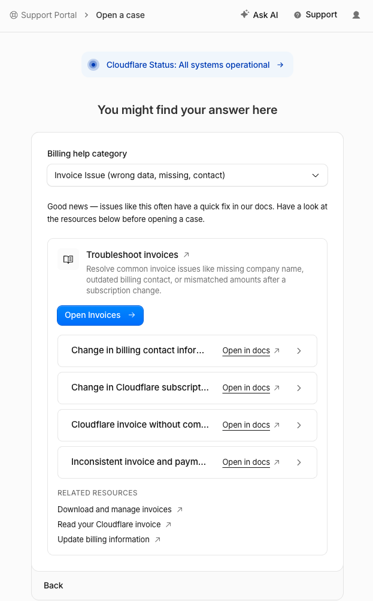
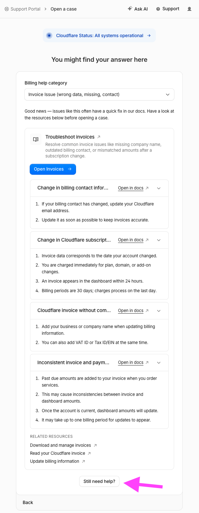

# cloudflare-receipt-downloader

Download all your **Cloudflare payment receipts** (not invoices) as PDFs with one command.

```console
$ cf-receipts
My Account: 13 billing history item(s)
  saved REC_2026-10-09_Cloudflare_10.46USD_DomainRegistration-example.com_IN-83003564.pdf
  saved REC_2026-10-21_Cloudflare_12.20USD_DomainTransfer-example.dev_IN-84964230.pdf
  ...
Done: 7 saved, 0 already present, 0 unavailable.
```

## Why

Businesses need receipts (proof of payment) for expense and tax records. An invoice doesn't show that a charge was paid: it has no payment date, payment method or "paid" status.

The Cloudflare dashboard (**Billing → Invoices and documents**) only offers invoices. The only way to get a receipt is to open each invoice, click its **Pay online** link, and click **Download receipt** on the Stripe page, one by one. Those Stripe links also expire (after about six months), and after that a new link has to be requested from Cloudflare support, whose case form is hard to find (see [Contacting Cloudflare billing support](#contacting-cloudflare-billing-support)).

Cloudflare support has confirmed by email that self-serve accounts don't get a separate receipt per charge, and that the invoice is what's available. Stripe does generate a receipt for every paid invoice ([Stripe docs](https://docs.stripe.com/receipts)); Cloudflare just doesn't show it in the dashboard. A **Download receipt** option has been requested. Until it exists, this tool does the clicking for you.

`cf-receipts` fetches the receipt for every paid invoice on your account, names the files consistently for bookkeeping, and skips the ones you already have. Run it regularly to save each receipt before its link expires.

## Install

Requires Python 3.9+.

```bash
pipx install git+https://github.com/balvenie30/cloudflare-receipt-downloader
# or: pip install git+https://github.com/balvenie30/cloudflare-receipt-downloader
```

## Create an API token

1. Cloudflare dashboard → **My Profile → API Tokens → Create Token → Create Custom Token**.
2. Permissions: **Account · Billing · Read**. Nothing else is needed.
3. Account Resources: include the account(s) you want receipts for.
4. Create it and copy the token.

If listing your accounts fails with a permissions error, pass your account ID explicitly with `--account <ACCOUNT_ID>`. It's in the dashboard URL after `dash.cloudflare.com/`.

Give it to `cf-receipts` in any of these ways (first match wins):

- `--token <TOKEN>`
- environment variable `CLOUDFLARE_API_TOKEN`
- a `.env` file in the current folder containing `CLOUDFLARE_API_TOKEN=<TOKEN>` (see [`.env.example`](.env.example))

## Usage

```bash
cf-receipts                          # save new receipts to ./receipts
cf-receipts -o ~/Bookkeeping/Receipts
cf-receipts --dry-run                # list what would be saved, write nothing
cf-receipts --account <ACCOUNT_ID>   # only one account (repeatable)
cf-receipts --prefix ""              # file names without the "REC_" prefix
```

Run it again any time. It only downloads receipts that aren't in the output folder yet.

### File names

```
REC_2026-10-09_Cloudflare_10.46USD_DomainRegistration-example.com_IN-83003564.pdf
│   │          │          │        │                                │
│   │          │          │        │                                └ Cloudflare invoice number
│   │          │          │        └ what was bought (from the receipt's line item)
│   │          │          └ amount + currency
│   │          └ vendor
│   └ charge date (sorts chronologically, matches your bank statement)
└ document type (receipt)
```

A receipt counts as "already present" if any file in the output folder ends with `_<invoice number>.pdf`, so you can rename the rest of the file name freely.

## How it works

When you run `cf-receipts`, it does this:

1. **Reads your API token** from `--token`, the `CLOUDFLARE_API_TOKEN` environment variable, or `.env`.
2. **Asks Cloudflare for your billing history**, the list of every charge on each account the token can see.
3. **Skips charges that cost $0 and invoices that aren't paid yet.** There is no receipt for those.
4. **Skips receipts you already have.** If a file in the output folder already ends with that charge's invoice number (like `_IN-83003564.pdf`), it moves on.
5. **Downloads the invoice in memory** and pulls out its **Pay online** Stripe link, the same link you'd click by hand. The invoice itself is never saved.
6. **Asks Stripe for the receipt behind that link.** If the link has expired, it reports the receipt as *unavailable* and moves on.
7. **Downloads the receipt PDF.**
8. **Names the file** from the charge date, amount, currency, the receipt's line item and the invoice number, e.g. `REC_2026-10-09_Cloudflare_10.46USD_DomainRegistration-example.com_IN-83003564.pdf`.
9. **Saves it** to the output folder and prints the file name.
10. **Prints a summary** of how many receipts were saved, already present, or unavailable.

With `--dry-run` it does steps 1–8 but saves nothing; it only lists what it would save.

## Limitations

- **Unofficial endpoints.** The Cloudflare invoice-PDF route and the Stripe receipt lookup are not publicly documented. They work as of October 2026 but may change without notice. Please open an issue if it breaks.
- **Expired Stripe links.** Older invoices' Stripe links can expire, and then the receipt can't be fetched. The tool reports these as *unavailable*. Cloudflare billing support can send you a fresh link.
- **Enterprise accounts** billed directly by Cloudflare's accounting team aren't covered.

### Contacting Cloudflare billing support

The case form is hard to reach. As of October 2026, the Support Portal first shows suggested articles, and the **Still need help?** button that leads to **Submit a support case** only appears after you expand every row in that list. Expand them all, then click **Still need help?**.

<details>
<summary><b>📷 Show screenshots</b> (before and after expanding the rows)</summary>
<br>

**Before:** rows collapsed, no way to open a case.



**After:** every row expanded, and the **Still need help?** button appears at the bottom.



</details>

## Security

- The token only needs **Billing Read**, which can't change anything in your account.
- `.env`, `receipts/` and `*.pdf` are in `.gitignore`. Don't commit tokens or receipts.
- The token is only sent to `api.cloudflare.com`. Stripe requests don't carry it.

## Development

```bash
git clone https://github.com/balvenie30/cloudflare-receipt-downloader
cd cloudflare-receipt-downloader
pip install -e ".[test]"
pytest
```

## Disclaimer

Not affiliated with, endorsed by, or sponsored by Cloudflare, Inc. or Stripe, Inc. "Cloudflare" and "Stripe" are trademarks of their respective owners.

## License

[MIT](LICENSE)
